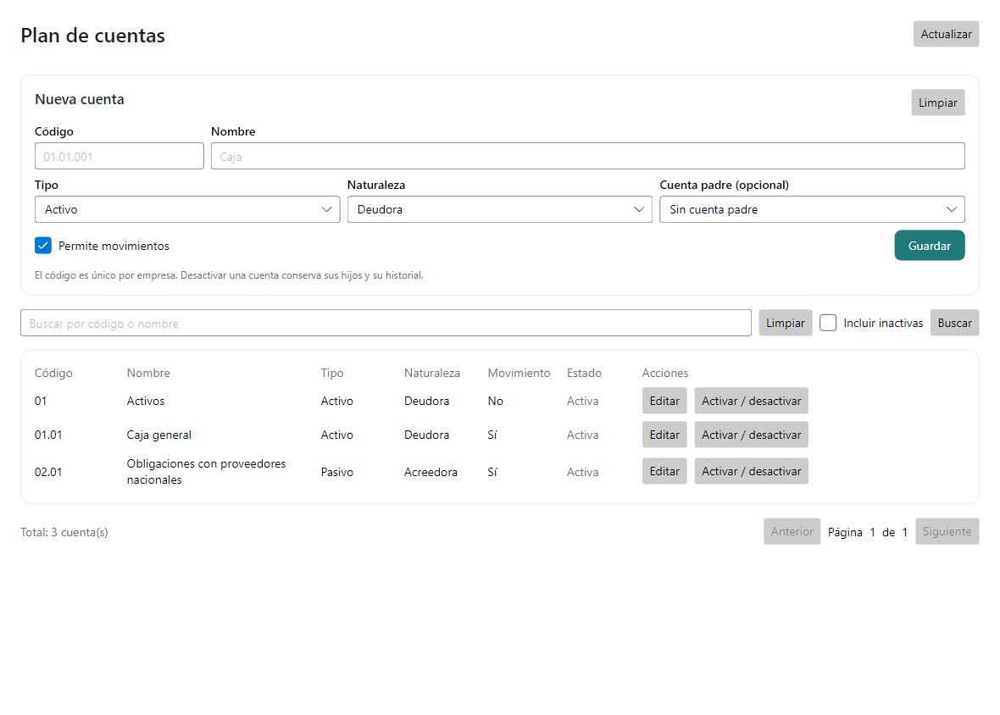
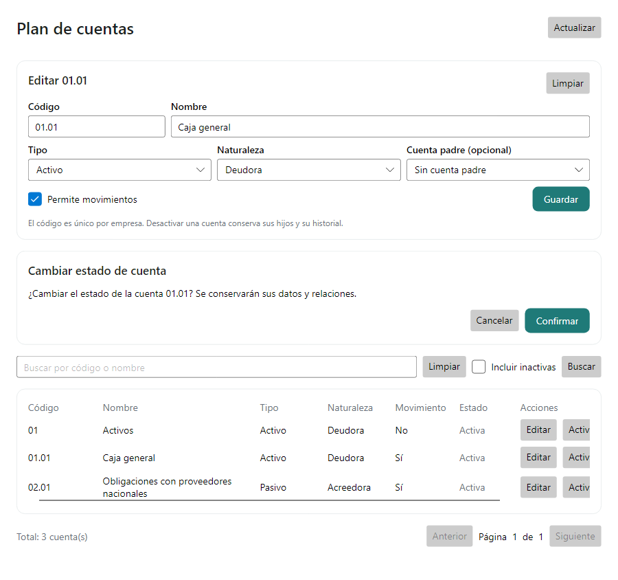

# ACC-01: evidencia de validación local

Fecha: 19 de noviembre de 2026. Responsable: Romero.
Rama: `feature/accounting-plan-cuentas`, actualizada desde `origin/main` (`8c3126c`).
Referencia: issue [#6](https://github.com/NoeliaMendoza/erp-contable/issues/6).

## Resultados

| Comprobación | Resultado |
|---|---|
| Compilación Debug de ERP.slnx | Aprobada, 0 errores y 0 advertencias |
| Compilación Release de ERP.slnx | Aprobada, 0 errores y 0 advertencias |
| Formato de toda la solución | Aprobado con `--verify-no-changes --severity warn` |
| Pruebas unitarias | 162 aprobadas, 0 fallidas, 0 omitidas |
| Pruebas de arquitectura | 16 aprobadas, 0 fallidas, 0 omitidas |
| Pruebas de integración con PostgreSQL 17 | 98 aprobadas, 0 fallidas, 0 omitidas |
| Total de pruebas | 276 aprobadas |
| Modelo Accounting frente a migración | Sin cambios pendientes |
| Vista real de Avalonia a 1180 y 900 píxeles | Revisada con datos ficticios |

En integración se creó una base temporal y se aplicaron las migraciones mediante el migrador real.
La API usó el rol `erp_app` sin privilegios para saltarse RLS. Se verificaron las reglas de #6,
la auditoría, los ciclos concurrentes y el aislamiento por SQL directo.
La suite general también incluyó las pruebas OIDC existentes del equipo.

La primera ejecución detectó una expectativa incorrecta de paginación: el código normalizado se esperaba
en minúsculas. Se corrigió la expectativa a mayúsculas y la ejecución final completa aprobó las 98 pruebas.
La comprobación de esquema contable ahora falla si falta la migración, en vez de omitir las pruebas.

## Revisión visual

Se renderizó `AccountsView` con su ViewModel real y los estilos/controles compartidos.
El programa temporal de revisión vive en `artifacts/acc01-review` (ignorado por Git).
**Los datos y la respuesta HTTP de esta revisión visual son ficticios.** No es una demostración de login,
navegación desde el shell ni persistencia; esa última se verificó por las pruebas de integración.

Se revisaron formulario, selector de padre, filas con nombres largos, edición, confirmación de estado,
paginación y desplazamiento horizontal. Se corrigió el solapamiento de columnas en ventanas estrechas.

Vista amplia, datos ficticios:

Vista estrecha y confirmación, datos ficticios:

## Pendiente de revisión del equipo

- Demostración manual desde el shell de Orvix con sesión real, selección/cambio de empresa y teclado,
  según el guion de `contabilidad.md`. No se presenta como comprobada por el render de la vista.
- Revisión de la migración ya existente y de los cambios mínimos de navegación/migrador.
- Publicación e integración en `main` exclusivamente por el flujo de revisión de Noe.
- Coordinar el acuerdo compartido #12 antes de implementar #17.

No se ejecutaron migraciones ni operaciones contra Neon. No se generaron migraciones nuevas en esta revisión.
No se cambió la autenticación ni los módulos de otros integrantes.

Los registros locales están en `artifacts/acc01-validation` (ignorados por Git):
`build-final.log`, `unit-final.log`, `architecture-final.log`, `integration-final.log`,
`format-final.log` y `accounting-model-final.log`.
